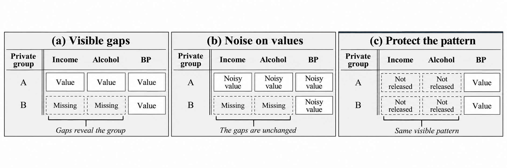
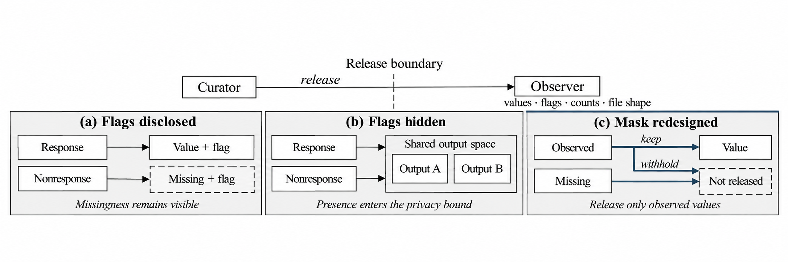
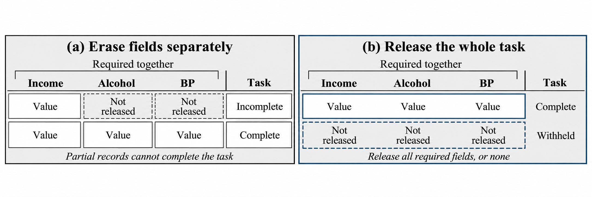

# Who Is Missing Leaks

**A blank field is a randomized response. Noise on the reported values does not remove it.**

Availability is the first stage of the release. A disclosed pattern is charged its log-likelihood ratio. A hidden pattern is charged the optimum of a transport program. When the response law is unknown, fields that a joint analysis needs leave as one block, and only values that were actually observed are released.

<p align="center">
  <a href="#quick-start"><strong>Quick start</strong></a>
  &nbsp;·&nbsp;
  <a href="#reproduce"><strong>Reproduce</strong></a>
  &nbsp;·&nbsp;
  <a href="#layout"><strong>Layout</strong></a>
</p>

## The blank is the channel

Published flags show who did not answer. Noise on the supplied values leaves those flags in place. The channel closes when the pattern itself is edited and blanks are not filled.

<p align="center">
  
</p>

## Three regimes

A disclosed pattern puts response and nonresponse in disjoint cells. A hidden pattern overlaps those cells, and the worst-case level is a linear program. Faithful erasure edits the mask before release.

<p align="center">
  
</p>

## Field retention is not a joint analysis

Rotating fields across units keeps more fields. A joint task needs those fields released together, as one block.

<p align="center">
  
</p>

## Quick start

Python 3.10+ recommended.

```bash
pip install numpy pandas scipy statsmodels scikit-learn
python scripts/smoke_synthetic.py
```

The smoke check is closed form. It does not need a survey file.

## Reproduce

Survey and census extracts stay local. Point the scripts at them with environment variables, then run the suite. Outputs go under `results/`, which is not part of this repository.

```bash
export WM1_NHANES=/path/to/n1516.csv
export WM1_ACS=/path/to/acs_ca2021_adults.csv
bash run_all_im_v6.sh
```

Census public-use microdata can be turned into the adult extract with:

```bash
python scripts/build_acs_pums_extract.py /path/to/psam_p06.csv
```

## Layout

```
im_missingness_v6/   accounting, protection, and theory checks
scripts/             smoke check and census extract builder
docs/figures/        method figures
```

## Notes

The protection grid reports the share of replications whose realized level exceeds the declared budget. Robust balancing at four times the calibration sample and budget 1 is 22 percent over budget.
